# React App on AWS EC2: Terraform + GitHub Actions CI/CD

This project deploys a **React** web app to **AWS EC2** (served by **nginx**). The AWS infrastructure is created with **Terraform**, and **GitHub Actions** pipelines handle the deploys. There are **three environments** (Dev, QA, Prod).

Along the way it uses several real-world practices:

- ✅ **Infrastructure as Code**: every AWS resource is defined in Terraform; nothing is clicked together by hand (except one state bucket, explained below)
- ✅ **No AWS keys stored in GitHub**: GitHub logs in to AWS with **OIDC** (short-lived tokens)
- ✅ **No SSH, no port 22**: deploys go through **AWS Systems Manager (SSM)**
- ✅ **No hard-coded IPs**: pipelines find servers by their **tags**
- ✅ **Remote state** in S3 with locking, shared by laptops and pipelines
- ✅ **Separate pipelines** for infrastructure and for the application
- ✅ **Dev / QA / Prod** environments built from **one reusable Terraform module**
- ✅ **Least privilege**: each environment's deploy role can only touch its own server

> This README is written so that **beginners** can follow it. If a term is new to you, check the [Glossary](#18-glossary) at the end.

---

## Table of contents

1. [What this project does](#1-what-this-project-does)
2. [Architecture](#2-architecture)
3. [Tech stack](#3-tech-stack)
4. [Repository structure](#4-repository-structure)
5. [The AWS resources](#5-the-aws-resources)
6. [Environments: Dev, QA, Prod](#6-environments-dev-qa-prod)
7. [Terraform state and the bootstrap folder](#7-terraform-state-and-the-bootstrap-folder)
8. [How GitHub logs in to AWS (OIDC)](#8-how-github-logs-in-to-aws-oidc)
9. [How the app is deployed without SSH (SSM)](#9-how-the-app-is-deployed-without-ssh-ssm)
10. [The CI/CD pipelines](#10-the-cicd-pipelines)
11. [Setting up from scratch](#11-setting-up-from-scratch)
12. [Day-to-day usage](#12-day-to-day-usage)
13. [How-to guides: changing and adding things](#13-how-to-guides-changing-and-adding-things)
14. [Destroying environments](#14-destroying-environments)
15. [Costs](#15-costs)
16. [Troubleshooting](#16-troubleshooting)
17. [Design decisions and real-world notes](#17-design-decisions-and-real-world-notes)
18. [Glossary](#18-glossary)
19. [Command cheat sheet](#19-command-cheat-sheet)

---

## 1. What this project does

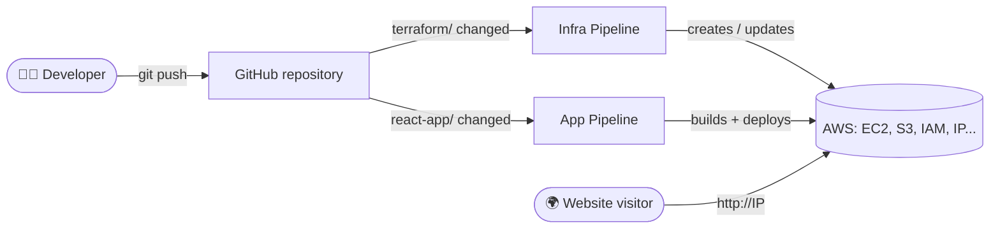

1. You change **infrastructure code** (`terraform/`) and push. The **Infra Pipeline** creates or updates the AWS resources.
2. You change **app code** (`react-app/`) and push. The **App Pipeline** tests and builds the React app and puts it on the server.
3. Visitors open the server's public IP in a browser, and **nginx** serves the React app.

---

## 2. Architecture

### 2.1 One environment (for example Dev)

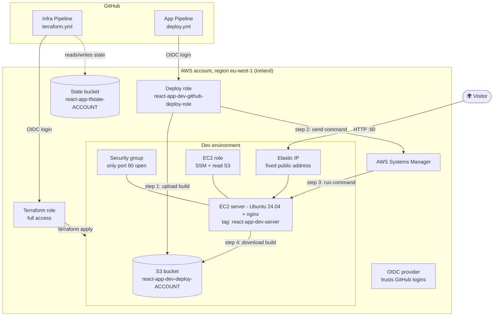

### 2.2 All three environments

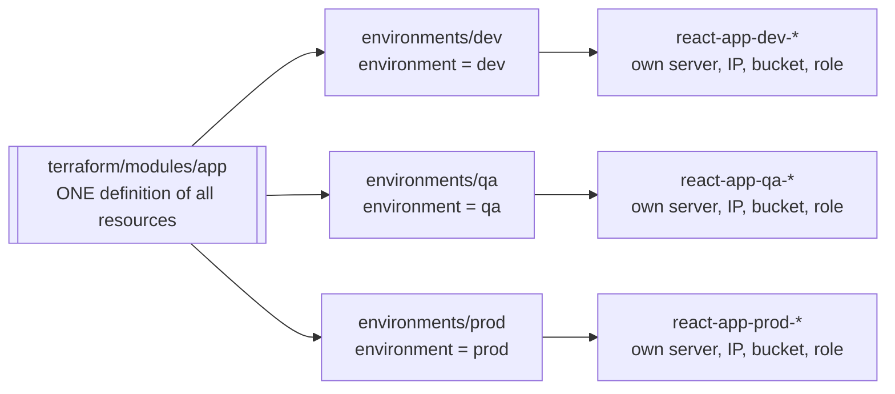

Each environment is a **complete, independent copy**, with its own server, IP, S3 bucket, deploy role and state file.

---

## 3. Tech stack

| Tool | Version | Used for |
|---|---|---|
| React (Create React App) | React 19, `react-scripts` 5 | The web application |
| Node.js | 22 (in the pipeline) | Building and testing the app |
| nginx | Ubuntu package | Web server on EC2 |
| Ubuntu | 24.04 LTS | Server operating system |
| Terraform | 1.15.9 | Infrastructure as Code |
| AWS provider for Terraform | `~> 6.0` | Talking to AWS |
| GitHub Actions | – | CI/CD pipelines |
| AWS services | – | EC2, Elastic IP, S3, IAM, SSM, STS |

---

## 4. Repository structure

```
.
├── .github/workflows/
│   ├── terraform.yml          # INFRA PIPELINE: runs Terraform (plan + apply)
│   └── deploy.yml             # APP PIPELINE: tests, builds and deploys the React app
│
├── bootstrap/                 # ONE-TIME setup, run from a laptop, never destroyed
│   ├── oidc.tf                # Lets AWS trust GitHub's login tokens
│   ├── iam_terraform.tf       # The role the Infra Pipeline logs in with
│   ├── backend.tf             # Stores bootstrap's state in S3
│   ├── provider.tf            # AWS connection
│   ├── variables.tf           # Region, project name, GitHub repo
│   ├── outputs.tf             # Prints the Terraform role ARN
│   └── README.md
│
├── terraform/
│   ├── modules/app/           # ALL app resources, written ONCE and used by every environment
│   │   ├── ami.tf             # Finds the latest Ubuntu 24.04 image
│   │   ├── ec2.tf             # The EC2 server
│   │   ├── eip.tf             # Fixed public IP (Elastic IP)
│   │   ├── security_group.tf  # Firewall: only port 80 open
│   │   ├── s3.tf              # Bucket the build is uploaded to
│   │   ├── iam_ec2.tf         # Permissions for the server (SSM + read S3)
│   │   ├── iam_github.tf      # Permissions for the App Pipeline (deploy role)
│   │   ├── install_nginx.sh   # Runs on the server's first boot (installs nginx + AWS CLI)
│   │   ├── variables.tf       # Inputs: environment, instance_type, ...
│   │   └── outputs.tf         # Outputs: website_url, github_role_arn
│   │
│   ├── environments/
│   │   ├── dev/               # main.tf (uses the module), backend.tf, provider.tf, outputs.tf
│   │   ├── qa/                # same 4 files, environment = "qa"
│   │   └── prod/              # same 4 files, environment = "prod"
│   └── README.md
│
├── react-app/                 # The React application (Create React App)
│   ├── src/App.js             # Main page
│   ├── src/App.test.js        # Test that runs in the pipeline
│   └── package.json
│
├── .gitattributes             # Keeps *.sh files with Linux line endings (LF)
├── .gitignore                 # Ignores node_modules, build, .terraform, state files, keys...
└── README.md                  # This file
```

---

## 5. The AWS resources

Everything below is created **per environment** by [`terraform/modules/app`](terraform/modules/app). The names use the pattern `react-app-<env>-...`, for example `react-app-dev-server`.

| Resource | File | Name (Dev example) | What it does |
|---|---|---|---|
| Ubuntu image lookup | `ami.tf` | – | Reads the latest Ubuntu 24.04 image ID from a public AWS parameter published by Canonical |
| Security group | `security_group.tf` | `react-app-dev-sg` | Firewall. **Inbound: only port 80 (HTTP).** Outbound: everything (to install packages, reach SSM and S3) |
| EC2 instance | `ec2.tf` | `react-app-dev-server` | The web server (`t3.micro`). Runs `install_nginx.sh` on first boot |
| Elastic IP | `eip.tf` | `react-app-dev-eip` | A fixed public IP attached to the server, so it stays the same across stop/start and server replacement |
| S3 bucket | `s3.tf` | `react-app-dev-deploy-<ACCOUNT_ID>` | Where the pipeline uploads the React build; the server downloads it from here |
| EC2 IAM role + instance profile | `iam_ec2.tf` | `react-app-dev-ec2-role` | Lets the server **receive SSM commands** and **read** the S3 bucket |
| Deploy IAM role | `iam_github.tf` | `react-app-dev-github-deploy-role` | The role the **App Pipeline** logs in with (only for this environment) |

Every resource also gets these tags automatically (from `default_tags` in each environment's `provider.tf`):

| Tag | Example |
|---|---|
| `Project` | `react-app` |
| `Environment` | `dev` / `qa` / `prod` |
| `ManagedBy` | `terraform` |

### What happens on the server's first boot (`install_nginx.sh`)

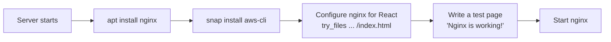

The `try_files $uri $uri/ /index.html` setting means that refreshing the page on a React route doesn't give a 404 error.

> ⚠️ The script only runs on **first boot**. Because of `user_data_replace_on_change = true`, changing the script makes Terraform **replace the server**. After that, run the App Pipeline again, because a new server only has the test page.

---

## 6. Environments: Dev, QA, Prod

### 6.1 How environments are built

The resources are written **once** in `terraform/modules/app/`. Each environment folder just **uses** that module with its own values:

```hcl
# terraform/environments/dev/main.tf
module "app" {
  source = "../../modules/app"

  environment   = "dev"
  instance_type = "t3.micro"
}
```

| | Dev | QA | Prod |
|---|---|---|---|
| Folder | `terraform/environments/dev` | `.../qa` | `.../prod` |
| Server tag | `react-app-dev-server` | `react-app-qa-server` | `react-app-prod-server` |
| S3 bucket | `react-app-dev-deploy-<ACCOUNT>` | `react-app-qa-deploy-<ACCOUNT>` | `react-app-prod-deploy-<ACCOUNT>` |
| Deploy role | `react-app-dev-github-deploy-role` | `react-app-qa-github-deploy-role` | `react-app-prod-github-deploy-role` |
| State file (in S3) | `react-app/dev/terraform.tfstate` | `react-app/qa/terraform.tfstate` | `react-app/prod/terraform.tfstate` |
| GitHub environment | `dev` | `qa` | `prod` (approval recommended) |
| Updated by | Every push (automatic) | Manual run | Manual run (+ approval) |

### 6.2 Promotion flow (Dev → QA → Prod)

This is how real teams release changes: test in Dev, then promote to QA, then Prod.

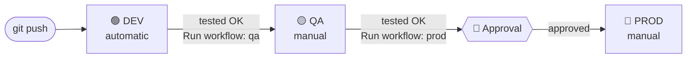

### 6.3 Why environments can't affect each other

1. **Separate state files.** `terraform destroy` in `qa/` only knows about QA's resources.
2. **Separate names.** Every resource name includes the environment.
3. **Separate deploy roles.** Each deploy role only trusts GitHub jobs running in **its own** GitHub environment:
   ```
   repo:<owner>@<id>/<repo>@<id>:environment:dev   → only react-app-dev-github-deploy-role
   ```
   A Dev deploy can't log in with the Prod role. AWS rejects it.

---

## 7. Terraform state and the bootstrap folder

### 7.1 What is "state"?

Terraform keeps a file called **state** (`terraform.tfstate`). It's Terraform's record of *what it has created*. Without it, Terraform would try to create everything again.

This project stores state in an **S3 bucket** (remote state), so that your laptop **and** the GitHub pipeline use the same record:

```
S3 bucket: react-app-tfstate-<ACCOUNT_ID>   (versioning ON)
├── bootstrap/terraform.tfstate        ← bootstrap/ folder
└── react-app/
    ├── dev/terraform.tfstate          ← terraform/environments/dev
    ├── qa/terraform.tfstate           ← terraform/environments/qa
    └── prod/terraform.tfstate         ← terraform/environments/prod
```

`use_lockfile = true` in each `backend.tf` creates a small lock file while Terraform runs, so **two runs can't change the same environment at the same time**.

### 7.2 Why there's a `bootstrap/` folder

The pipeline needs a **way in** to AWS: the OIDC provider and the Terraform role. If those were inside `terraform/`, running `terraform destroy` would delete the pipeline's own login, and the pipeline could never log in again to rebuild anything.

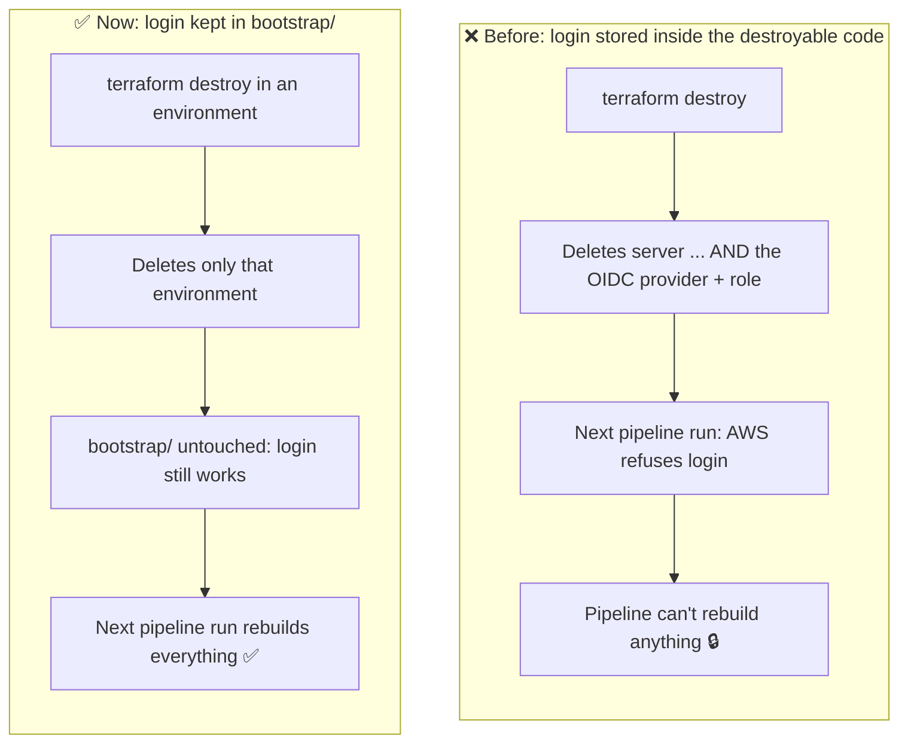

**The rule:** whatever the pipeline needs in order to run (its **login** and its **state storage**) must not be managed by the pipeline itself.

| Thing | Created by | Ever destroyed? |
|---|---|---|
| State bucket `react-app-tfstate-<ACCOUNT>` | AWS CLI, by hand, once | No (only if you remove the whole project) |
| `bootstrap/` (OIDC provider + Terraform role) | `terraform apply` from a laptop, once | No (only if you remove the whole project) |
| `terraform/environments/*` | The Infra Pipeline | Yes, safe to destroy and rebuild |

---

## 8. How GitHub logs in to AWS (OIDC)

**GitHub creates** the login token. **AWS only checks it**, and if it's valid, gives GitHub temporary AWS keys. No permanent AWS keys are stored in GitHub.

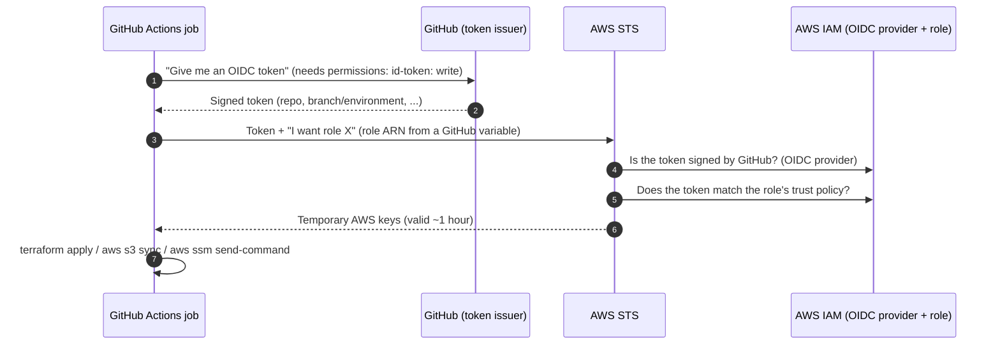

### What's inside the token?

The most important field is `sub` (subject). This repo's GitHub account uses the **ID-based format**:

```
Job without an environment:  repo:suriya1808@81013423/Terraform@1422403913:ref:refs/heads/dev
Job in an environment:       repo:suriya1808@81013423/Terraform@1422403913:environment:prod
```

The numbers are the **owner ID** and **repository ID**. They never change, even if the repo is renamed. Each role's trust policy checks this value.

> 💡 **Using this project in your own repo?** Find your IDs at `https://api.github.com/repos/<owner>/<repo>`: `owner.id` and `id`. Put them in `github_repo` in both `bootstrap/variables.tf` and `terraform/modules/app/variables.tf`.

### The roles, and who uses them

| Role | Defined in | Trusts (who can log in) | Permissions | Used by |
|---|---|---|---|---|
| `react-app-terraform-apply-role` | `bootstrap/iam_terraform.tf` | This repo, any branch or environment | `AdministratorAccess` | Infra Pipeline |
| `react-app-<env>-github-deploy-role` | `terraform/modules/app/iam_github.tf` | This repo, **only** GitHub environment `<env>` | Upload to its S3 bucket, find servers, send SSM command to **its** server | App Pipeline |
| `react-app-<env>-ec2-role` | `terraform/modules/app/iam_ec2.tf` | EC2 service | Receive SSM commands, read its S3 bucket | The EC2 server itself |

### GitHub variables

| Where (in GitHub) | Name | Value |
|---|---|---|
| Repository variable | `TF_APPLY_ROLE_ARN` | `arn:aws:iam::<ACCOUNT>:role/react-app-terraform-apply-role` |
| Environment `dev` → variable | `AWS_ROLE_ARN` | `arn:aws:iam::<ACCOUNT>:role/react-app-dev-github-deploy-role` |
| Environment `qa` → variable | `AWS_ROLE_ARN` | `arn:aws:iam::<ACCOUNT>:role/react-app-qa-github-deploy-role` |
| Environment `prod` → variable | `AWS_ROLE_ARN` | `arn:aws:iam::<ACCOUNT>:role/react-app-prod-github-deploy-role` |

These are **Variables, not Secrets**. An ARN isn't a password, and the trust policy is what actually protects the role. Workflows read them with `${{ vars.NAME }}`. When a job runs in an environment, that environment's `AWS_ROLE_ARN` is used.

---

## 9. How the app is deployed without SSH (SSM)

Port 22 is **closed**, and there are **no SSH keys** anywhere. Instead, the pipeline asks **AWS Systems Manager (SSM)** to run a command on the server. The SSM agent comes preinstalled on Ubuntu images and only makes **outbound** connections, so no inbound port is needed.

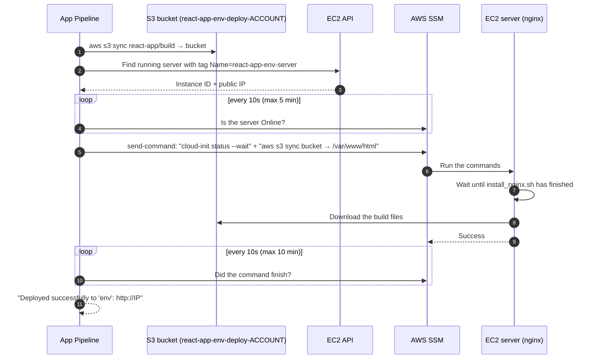

---

## 10. The CI/CD pipelines

There are **two independent pipelines**:

| Pipeline | File | Starts automatically when... | Manual run |
|---|---|---|---|
| **Infra Pipeline (Terraform)** | [`.github/workflows/terraform.yml`](.github/workflows/terraform.yml) | Files in `terraform/**` change (any branch). It updates **Dev**. | Actions → Run workflow → choose `dev` / `qa` / `prod` |
| **App Pipeline (Deploy React App)** | [`.github/workflows/deploy.yml`](.github/workflows/deploy.yml) | Files in `react-app/**` change (any branch). It deploys to **Dev**. | Actions → Run workflow → choose `dev` / `qa` / `prod` |

### 10.1 Which pipeline runs?

| You push changes in... | Infra Pipeline | App Pipeline |
|---|---|---|
| only `terraform/` | ✅ runs (Dev) | – |
| only `react-app/` | – | ✅ runs (Dev) |
| both | ✅ runs (Dev) | ✅ starts, **waits** for Infra to finish, then deploys |
| only `.github/workflows/`, `README.md`, `bootstrap/` | – | – |

### 10.2 Infra Pipeline steps

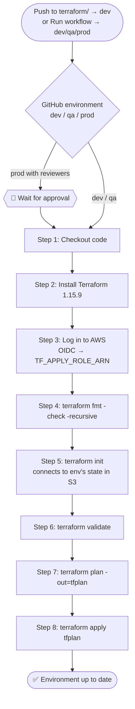

- It runs inside `terraform/environments/<env>`.
- `concurrency: terraform-<env>` means two Terraform runs on the **same** environment never overlap.
- If nothing changed, the plan says **"No changes"**, and the apply does nothing.

### 10.3 App Pipeline steps

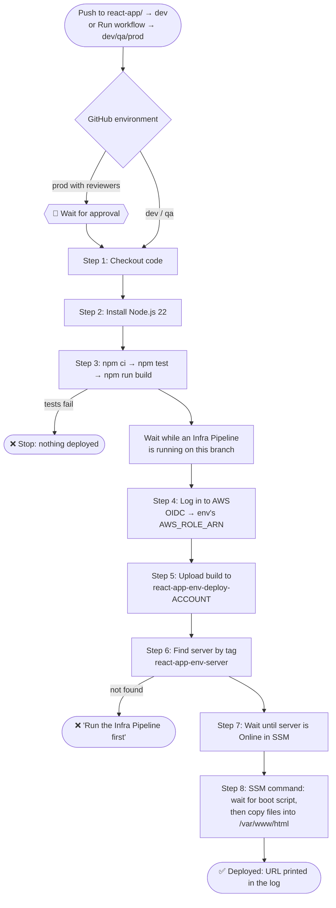

### 10.4 How "trigger" and "manual run" work in the YAML

```yaml
on:
  push:
    branches: ["**"]          # any branch
    paths:
      - "react-app/**"        # ...but only when these files change
  workflow_dispatch:          # adds the "Run workflow" button
    inputs:
      environment:
        type: choice
        options: [dev, qa, prod]
        default: dev

jobs:
  deploy:
    environment: ${{ inputs.environment || 'dev' }}   # on a push, inputs is empty, so 'dev'
```

> ℹ️ GitHub only shows the **Run workflow** button for workflows that exist on the **default branch (`main`)**. Merge your workflow changes into `main` first.

---

## 11. Setting up from scratch

Follow these steps in order if you're setting this project up in **your own** AWS account and GitHub repo.

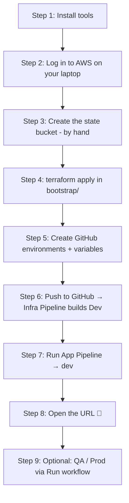

### Step 1: Install tools

- [Terraform](https://developer.hashicorp.com/terraform/install) (1.15.x)
- [AWS CLI v2](https://docs.aws.amazon.com/cli/latest/userguide/getting-started-install.html)
- [Git](https://git-scm.com/) and [Node.js](https://nodejs.org/) (to run the app locally)

### Step 2: Log in to AWS on your laptop

Choose **one** option (PowerShell examples):

```powershell
# Option A: environment variables (only last for this terminal window)
$env:AWS_ACCESS_KEY_ID="your-access-key"
$env:AWS_SECRET_ACCESS_KEY="your-secret-key"
$env:AWS_DEFAULT_REGION="eu-west-1"

# Option B: browser login
aws login

# Check that it works (shows your account ID)
aws sts get-caller-identity
```

> ⚠️ Never put AWS keys in `.tf` files or commit them to Git.

### Step 3: Create the state bucket (once, by hand)

Replace `047194654624` with **your** account ID everywhere in this project (`backend.tf` files and the commands below).

```powershell
aws s3api create-bucket --bucket react-app-tfstate-047194654624 --region eu-west-1 --create-bucket-configuration LocationConstraint=eu-west-1
aws s3api put-bucket-versioning --bucket react-app-tfstate-047194654624 --versioning-configuration Status=Enabled
```

### Step 4: Create the bootstrap resources (once)

Set `github_repo` in `bootstrap/variables.tf` and `terraform/modules/app/variables.tf` to your own repo IDs (see [section 8](#whats-inside-the-token)). Then:

```powershell
cd bootstrap
terraform init
terraform apply     # creates: OIDC provider, Terraform role, admin policy attachment
terraform output -raw terraform_apply_role_arn
```

### Step 5: Configure GitHub

1. **Repository variable:** go to **Settings → Secrets and variables → Actions → Variables → New repository variable**.
   - `TF_APPLY_ROLE_ARN` = the output from step 4
2. **Environments:** go to **Settings → Environments → New environment**, and create `dev`, `qa` and `prod`. In **each**, add an **environment variable**:
   - `AWS_ROLE_ARN` = `arn:aws:iam::<ACCOUNT>:role/react-app-<env>-github-deploy-role`
3. **Recommended for Prod:** in the `prod` environment, enable **Required reviewers** and add yourself.

> The deploy role ARNs follow a fixed pattern, so you can add them **before** the roles exist.

### Step 6: Push → the Infra Pipeline builds Dev

```powershell
git add .
git commit -m "Initial setup"
git push origin main
```

Watch **Actions → Infra Pipeline (Terraform)**. It creates **10 resources** for Dev.

### Step 7: Deploy the app to Dev

Go to **Actions → App Pipeline (Deploy React App) → Run workflow**, choose branch `main` and environment `dev`, and click **Run workflow**.

### Step 8: Open the website

The last line of the **Deploy on server** step prints the URL:

```
Deployed successfully to 'dev': http://x.x.x.x
```

You can also get it from your laptop:

```powershell
cd terraform/environments/dev
terraform init
terraform output website_url
```

### Step 9 (optional): QA and Prod

1. **Infra Pipeline → Run workflow → `qa`**, then **App Pipeline → Run workflow → `qa`**.
2. Do the same for **`prod`**. Approve the run if reviewers are enabled.

---

## 12. Day-to-day usage

| I want to... | Do this |
|---|---|
| Change the website | Edit `react-app/src/...` → push → **Dev** updates automatically |
| Release the website to QA / Prod | **Actions → App Pipeline → Run workflow →** `qa` / `prod` |
| Change infrastructure for all environments | Edit `terraform/modules/app/...` → push (Dev updates) → **Run Infra Pipeline** for `qa`, then `prod` |
| Change infrastructure for one environment | Edit `terraform/environments/<env>/main.tf` → push → **Run Infra Pipeline** for that environment (not needed for Dev) |
| Find an environment's URL | End of the App Pipeline log, or `terraform output website_url` in the environment folder |
| Try a Terraform change safely | `cd terraform/environments/dev` → `terraform plan` (shows changes, applies nothing) |
| Approve a Prod run | Open the run → **Review deployments** → tick `prod` → **Approve and deploy** |
| Run the React app locally | `cd react-app` → `npm install` → `npm start` → http://localhost:3000 |

### Running a pipeline by hand (step by step)

1. Open your repository on GitHub and click the **Actions** tab.
2. In the left sidebar, click the pipeline (**Infra Pipeline** or **App Pipeline**).
3. Click **Run workflow ▾** on the right.
4. **Use workflow from:** choose the branch (usually `main`).
5. **Environment:** choose `dev`, `qa` or `prod`.
6. Click the green **Run workflow** button, then click the new run to watch the logs.

---

## 13. How-to guides: changing and adding things

### 13.1 Change a setting for ONE environment (for example a bigger server for Prod)

Edit only that environment's `main.tf`:

```hcl
# terraform/environments/prod/main.tf
module "app" {
  source = "../../modules/app"

  environment   = "prod"
  instance_type = "t3.small"   # changed for prod only
}
```

Then push, and run **Infra Pipeline → `prod`**.

> Changing `instance_type` **stops and restarts** the server (about 1 minute of downtime). The Elastic IP and website files stay.

### 13.2 Add a NEW setting that environments can choose

Example: let each environment choose its **disk size**.

**1. Add a variable to the module** (`terraform/modules/app/variables.tf`):
```hcl
variable "disk_size_gb" {
  description = "Size of the server's disk in GB"
  type        = number
  default     = 8   # environments that don't set it get 8 GB
}
```

**2. Use it in the resource** (`terraform/modules/app/ec2.tf`, inside `aws_instance "web"`):
```hcl
  root_block_device {
    volume_size = var.disk_size_gb
  }
```

**3. Set it where you want something other than the default** (`terraform/environments/prod/main.tf`):
```hcl
  disk_size_gb = 20
```

**4. Push**, then run the Infra Pipeline for each environment that should get the change.

### 13.3 Add a NEW resource to ALL environments

Add a new `.tf` file in `terraform/modules/app/`. Use `local.name` in names, so each environment gets a unique name.

Example: an S3 bucket for logs (`terraform/modules/app/s3_logs.tf`):
```hcl
# ---------------------------------------------------------
# S3 bucket for logs (one per environment)
# ---------------------------------------------------------
resource "aws_s3_bucket" "logs" {
  bucket        = "${local.name}-logs-${data.aws_caller_identity.current.account_id}"
  force_destroy = true
}
```

Push → Dev gets it automatically → run the Infra Pipeline for `qa` and `prod`.

**Checklist for a new resource:**
- [ ] Name includes `${local.name}` (so Dev, QA and Prod don't clash)
- [ ] If the **App Pipeline** must use it, add the permissions to `iam_github.tf`
- [ ] If the **server** must use it, add the permissions to `iam_ec2.tf`
- [ ] If someone needs its value (a URL, ARN...), add an `output` in `modules/app/outputs.tf` **and** in each `environments/<env>/outputs.tf`
- [ ] Run `terraform fmt -recursive` before pushing (the pipeline checks formatting)

### 13.4 Add a resource to ONE environment only

**Option A (simple):** put the resource directly in that environment's folder, for example a new file `terraform/environments/prod/extra.tf`. Only Prod will have it.

**Option B (reusable):** add an on/off switch to the module:
```hcl
# modules/app/variables.tf
variable "enable_logs_bucket" {
  type    = bool
  default = false
}

# modules/app/s3_logs.tf
resource "aws_s3_bucket" "logs" {
  count  = var.enable_logs_bucket ? 1 : 0     # 1 = create it, 0 = don't
  bucket = "${local.name}-logs-${data.aws_caller_identity.current.account_id}"
}

# environments/prod/main.tf
  enable_logs_bucket = true
```

### 13.5 Open a new port (for example HTTPS 443)

Add another `ingress` block in `terraform/modules/app/security_group.tf`:
```hcl
  ingress {
    description = "HTTPS"
    from_port   = 443
    to_port     = 443
    protocol    = "tcp"
    cidr_blocks = ["0.0.0.0/0"]
  }
```
> Opening port 443 alone isn't enough for HTTPS. nginx also needs an SSL certificate. A common setup is a load balancer with a free AWS Certificate Manager certificate.

### 13.6 Change what's installed on the server

Edit `terraform/modules/app/install_nginx.sh`, then:
1. Push. Terraform **replaces** the Dev server, because the script only runs on first boot.
2. Run the **App Pipeline → `dev`** to put the app back on the new server.
3. Repeat for `qa` / `prod` when ready.

> Keep `.sh` files with **LF** line endings. `.gitattributes` handles this, because Windows line endings (CRLF) break bash scripts on Linux.

### 13.7 Add a SECOND EC2 server

Adding another `aws_instance` isn't enough on its own. The current design assumes **one server per environment**:

| Part | Current behaviour | What you'd need to change |
|---|---|---|
| `eip.tf` | Attaches the IP to `aws_instance.web` | One EIP per server, or better, a **load balancer** |
| `iam_github.tf` | SSM permission for `aws_instance.web.arn` only | Allow every server (for example with a list of ARNs) |
| `deploy.yml` | Takes the **first** server with the tag | Target **all** servers with the tag: `aws ssm send-command --targets "Key=tag:Name,Values=$NAME-server"` |
| Traffic | Visitors reach one IP | An **Application Load Balancer** spreads traffic across servers |

> ⚠️ **Never give a test server the same `Name` tag** (`react-app-<env>-server`). The App Pipeline might pick it and fail with "access denied". Give it a different tag, such as `react-app-dev-test-server`.

### 13.8 Add a NEW environment (for example `staging`)

1. **Copy a folder:** `terraform/environments/qa` → `terraform/environments/staging`
2. **Change 3 values** in the new folder:
   - `main.tf`: `environment = "staging"`
   - `backend.tf`: `key = "react-app/staging/terraform.tfstate"`
   - `provider.tf`: `Environment = "staging"`
3. **Add `staging` to the dropdowns** in **both** workflows:
   ```yaml
   options: [dev, qa, staging, prod]
   ```
4. **In GitHub:** create the environment `staging` with variable `AWS_ROLE_ARN` = `arn:aws:iam::<ACCOUNT>:role/react-app-staging-github-deploy-role`
5. **Push**, then run **Infra Pipeline → `staging`**, then **App Pipeline → `staging`**.

You don't need to change `bootstrap/`, because the Terraform role already trusts any environment (`environment:*`).

### 13.9 Change the AWS region

The region is written in several places. Change **all** of them:
- `terraform/environments/*/provider.tf` (`region = ...`)
- `terraform/environments/*/backend.tf` (only if you move the state bucket too)
- `terraform/modules/app/variables.tf` (`aws_region`, used for the SSM document ARN)
- `bootstrap/variables.tf` and `bootstrap/backend.tf`
- `.github/workflows/*.yml` (`AWS_REGION`)

> Changing the region **re-creates** every resource in the new region. Destroy the old environments first.

### 13.10 Rename the project

`project_name` (default `react-app`) is used in every resource name and in the workflows (`NAME: react-app-...` in `deploy.yml`, and the state bucket name). Change it in **all** of them together, then rebuild the environments.

---

## 14. Destroying environments

Each environment is destroyed **separately**, from your laptop (logged in to AWS):

```powershell
cd terraform/environments/dev     # or qa, or prod
terraform init                    # first time only, on this laptop
terraform destroy                 # type "yes"
```

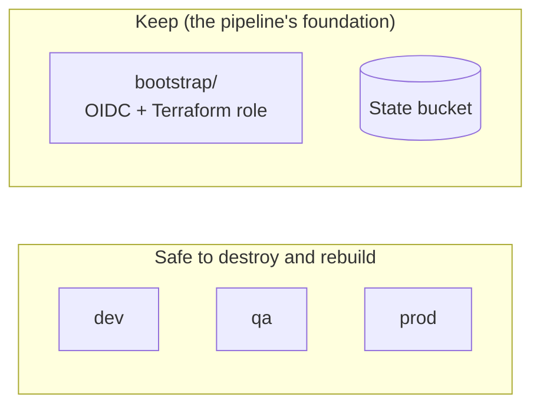

| Remove | How | Notes |
|---|---|---|
| One environment | `terraform destroy` in `terraform/environments/<env>` | Other environments are not affected |
| Everything (whole project) | 1) destroy dev, qa, prod → 2) `terraform destroy` in `bootstrap/` → 3) empty and delete the state bucket in the S3 console | Only when you're done with the project for good |

- **Dev comes back automatically** on the next push that changes `terraform/`. QA and Prod only come back when you run the Infra Pipeline for them.
- To stop pipelines rebuilding things, disable them: **Actions → (pipeline) → ⋯ → Disable workflow**.
- After a rebuild, the environment gets a **new** Elastic IP (a new URL), and you need to **run the App Pipeline** again to put the app back.

---

## 15. Costs

Rough costs for `eu-west-1` (check the AWS pricing pages for current numbers):

| Resource | Cost | Per |
|---|---|---|
| EC2 `t3.micro` | ~$0.01/hour (free tier eligible) | environment |
| Server disk (8 GB gp3) | ~$0.70/month | environment |
| Public IPv4 (Elastic IP) | ~$0.005/hour (~$3.60/month) | environment |
| S3 deploy bucket | Fractions of a cent (a few MB) | environment |
| State bucket | Fractions of a cent | project |
| IAM roles, OIDC provider, SSM Run Command | Free | – |

> 💡 Each environment you create is another server and IP. Destroy QA and Prod when you're not using them. An Elastic IP that's reserved but **not attached** to a running server is still charged.

---

## 16. Troubleshooting

All of these errors came up while building this project.

| Error | Cause | Fix |
|---|---|---|
| `No valid credential sources found` / `login session has expired` (laptop) | Your terminal has no valid AWS login. Environment variables only last for one window | Set the keys again in this window, or run `aws login`. Check with `aws sts get-caller-identity` |
| `Your query returned no results` (AMI) | The image name search matched nothing | The project now reads the Ubuntu image ID from Canonical's public SSM parameter (`ami.tf`) |
| `Credentials could not be loaded, please check your action inputs` | The role ARN variable is **empty**: missing, misspelled, saved as a **Secret** instead of a **Variable**, or not set in the GitHub **environment** | Add the variable with the exact name (`TF_APPLY_ROLE_ARN` / environment `AWS_ROLE_ARN`) |
| `Not authorized to perform sts:AssumeRoleWithWebIdentity` | The token doesn't match the role's trust policy, or the role doesn't exist. Common causes: the newer `sub` format with IDs, the wrong environment, or a wrong account in the ARN | Check `github_repo` uses the `owner@ID/repo@ID` format. Check the role exists (IAM → Roles) and the ARN is correct |
| `The web identity token provided could not be validated` | The **OIDC provider is missing** in AWS (for example it was destroyed) | `terraform apply` in `bootstrap/` |
| `Backend initialization required` | The backend settings changed, or this folder was never initialised | `terraform init` (or `terraform init -migrate-state` when moving state) |
| `S3 bucket ... does not exist` (on init) | The state bucket hasn't been created yet | Create it ([step 3](#step-3-create-the-state-bucket-once-by-hand)) |
| Pipeline fails at **Terraform format check** | A `.tf` file isn't formatted | Run `terraform fmt -recursive` in `terraform/`, then commit |
| `No running server found for '<env>'` | That environment's infrastructure doesn't exist | Run the **Infra Pipeline** for that environment first |
| Deploy fails with `AccessDenied` on `SendCommand` | The pipeline found a server it has no permission for (for example a test server with the **same Name tag**) | Give other servers a different `Name` tag |
| No **Run workflow** button | The workflow file isn't on the default branch (`main`) | Merge your branch into `main` |
| A pipeline ran "for no reason" | A push includes **all** files changed in all its commits; a new branch is compared against the default branch | Check which files the pushed commits changed (`git log --name-only`) |
| `react-app` shows as a non-clickable folder on GitHub | It was committed as a **submodule**, because `create-react-app` made its own `.git` folder | `git rm --cached react-app` → delete `react-app/.git` → `git add react-app` |
| Website shows "Nginx is working! React app coming soon." | The server is new and the app hasn't been deployed to it yet | Run the **App Pipeline** for that environment |
| Website URL changed | The environment was destroyed and rebuilt, so it has a new Elastic IP | Get the new URL from the App Pipeline log or `terraform output website_url` |

---

## 17. Design decisions and real-world notes

| Decision | Why |
|---|---|
| **OIDC instead of AWS access keys in GitHub** | No long-lived secrets to leak or rotate. Tokens expire within minutes, AWS keys within about an hour |
| **SSM instead of SSH** | No open port 22 and no keys to manage. Every command is logged in AWS |
| **Find servers by tag, not IP** | Servers can be replaced without updating any configuration |
| **Elastic IP** | A stable URL across server stop/start and replacement (not across a full destroy) |
| **S3 remote state + lock file** | Laptop and pipeline share one record of what exists, and parallel runs can't corrupt it |
| **`bootstrap/` kept separate** | The pipeline's login can't be destroyed by the pipeline |
| **One module + one folder per environment** | The code is written once; environments differ only in a few values, and each has its own state |
| **Separate deploy role per environment** | A Dev deploy can never touch Prod |
| **Separate Infra and App pipelines** | Infrastructure changes are rare and risky; app changes are frequent. They have different triggers and different permissions |
| **Saved plan (`-out=tfplan`) then apply** | Apply does exactly what the plan showed |

### What a larger production setup would usually add

This project is meant for learning, so some choices are simpler than you'd see in a large company:

| Here | Typical production setup |
|---|---|
| Infra Pipeline applies from **any branch** | `plan` on pull requests (posted as a comment for review); `apply` only after merging to `main` |
| Approval happens **before** the plan | A separate plan job, then an apply job that needs approval, so reviewers see the plan first |
| Terraform role has `AdministratorAccess` | A narrower policy with only the services Terraform manages |
| One server per environment, HTTP only | A load balancer, several servers (Auto Scaling), HTTPS with an ACM certificate, a domain name in Route 53 |
| The same build is rebuilt for each environment | Build **once**, store the artifact, and promote the **same** artifact Dev → QA → Prod |
| `npm` vulnerabilities and deprecation warnings ignored | Dependency updates and security scanning in CI |

---

## 18. Glossary

| Term | Meaning |
|---|---|
| **AMI** | Amazon Machine Image: the operating system template a server starts from |
| **ARN** | Amazon Resource Name: the full "address" of an AWS resource, for example `arn:aws:iam::123456789012:role/my-role` |
| **CI/CD** | Continuous Integration / Continuous Delivery: automatically testing, building and deploying on every change |
| **EC2** | Elastic Compute Cloud: virtual servers in AWS |
| **Elastic IP** | A fixed public IPv4 address that belongs to your AWS account and can be attached to a server |
| **Environment** | A complete, separate copy of the app and infrastructure (Dev, QA, Prod). Also a GitHub feature to group variables and approvals |
| **IAM role** | A set of AWS permissions that a service or a pipeline can "put on" temporarily |
| **Instance profile** | The container that attaches an IAM role to an EC2 server |
| **Module** | A reusable folder of Terraform code. Here, `modules/app` is used by all environments |
| **nginx** | A web server that serves the React files |
| **OIDC** | OpenID Connect: a standard for one system (GitHub) to prove an identity to another (AWS) using signed tokens |
| **`workflow_dispatch`** | `workflow_dispatch` adds a manual **Run workflow** button with optional inputs |
| **S3** | Simple Storage Service: file storage in AWS |
| **Security group** | A firewall around an EC2 server |
| **SSM** | AWS Systems Manager: lets you run commands on servers without SSH |
| **State (Terraform)** | Terraform's record of the resources it manages |
| **STS** | Security Token Service: the AWS service that gives out temporary credentials |
| **Trust policy** | The part of an IAM role that says **who** can use it |
| **user_data** | A script EC2 runs on a server's first boot (here: `install_nginx.sh`) |

---

## 19. Command cheat sheet

```powershell
# ---- AWS login check ----
aws sts get-caller-identity

# ---- Terraform (inside terraform/environments/<env>) ----
terraform init                  # connect to state + download providers (first time)
terraform plan                  # preview changes (changes nothing)
terraform apply                 # apply changes (normally done by the pipeline)
terraform output website_url    # show the website URL
terraform destroy               # delete this environment
terraform fmt -recursive        # format all .tf files (run inside terraform/)
terraform state list            # list resources Terraform manages

# ---- React app (inside react-app/) ----
npm install                     # install packages
npm start                       # run locally at http://localhost:3000
npm test                        # run tests
npm run build                   # production build into build/

# ---- Git ----
git add .
git commit -m "message"
git push origin <branch>
git log --name-only -5          # see which files recent commits changed
```

---

**Built step by step as a hands-on learning project:** from a single Terraform file and an SSH-free deploy to multi-environment CI/CD with OIDC, remote state and bootstrapping. 🚀
